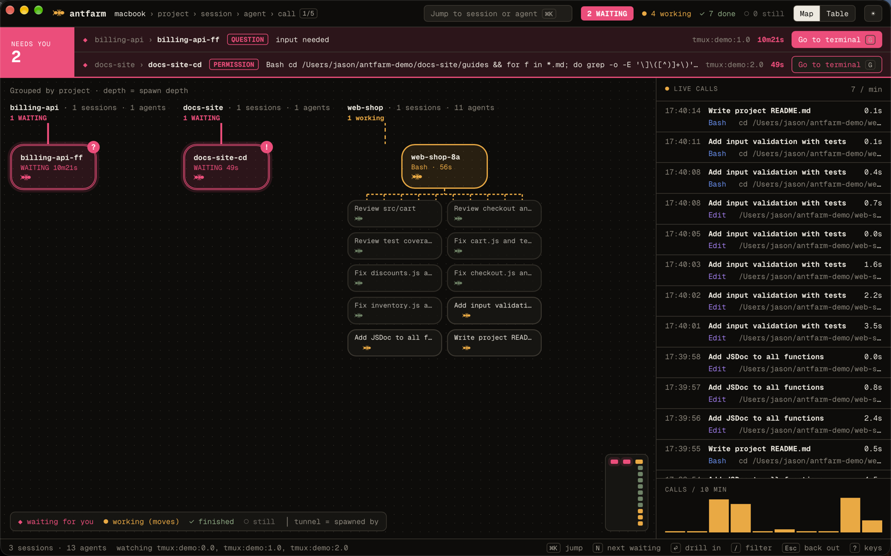
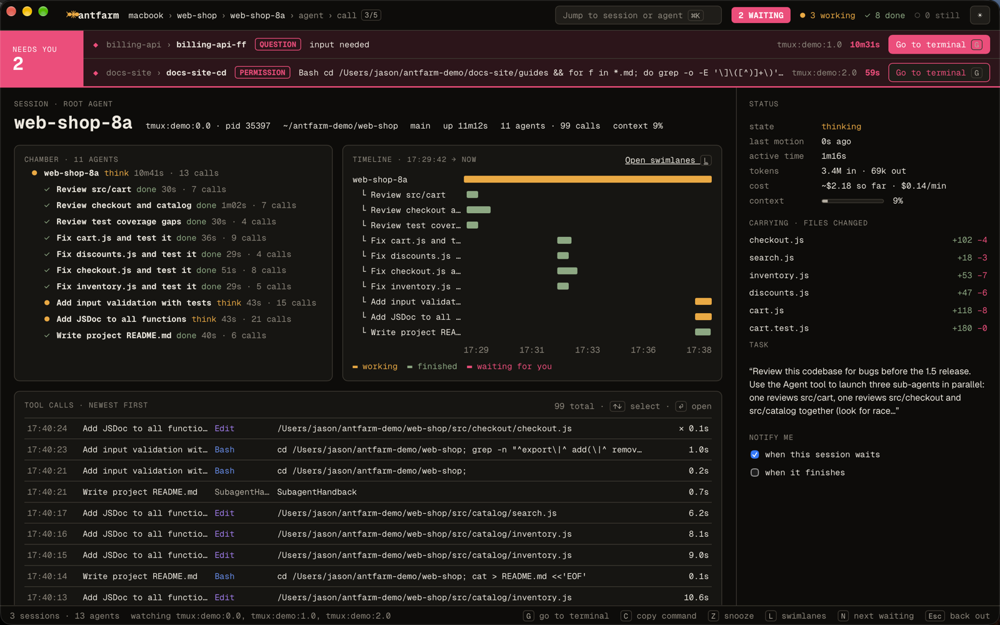
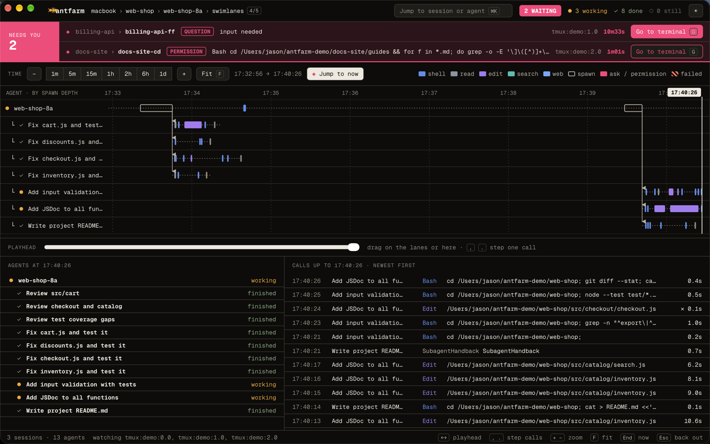
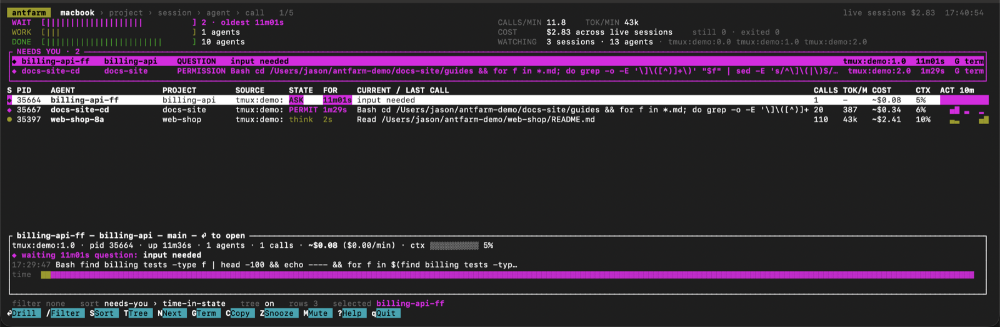

# antfarm 🐜


[](https://github.com/2Toad/antfarm/actions/workflows/ci.yml)
[](#license)

See what every Claude Code agent on your Mac is doing, live



antfarm watches every running Claude Code session on your machine, whether you started it in a terminal or in the VS Code extension. It follows the sub-agents each session spawns, and shows you which sessions are waiting on you, what every agent is doing right now, and what it's costing.

It works from the files Claude Code already writes under `~/.claude`. There are no hooks to install, no settings to change, and no wrapper to launch Claude through, and antfarm never writes to those files.

## Features

- **Who needs you.** Sessions waiting on a permission prompt or a question go to the top, with the command or question they're stuck on and how long they've waited.
- **Sub-agents as a tree.** Every agent a session spawns, how deep it is, what it's running, and whether it finished.
- **Swimlanes.** One lane per agent over time, with a bar per tool call. Scrub back to see what was running at any moment.
- **Cost and context.** Running cost per session and per minute, tokens, and how full each context window is.
- **Jump to the session.** One key brings the session's tmux pane, VS Code window, or terminal app to the front.
- **Notifications.** The desktop app pings you when a session starts waiting and shows the count in the menu bar.
- **Scriptable.** `antfarm ls` and `antfarm watch --json` for your own scripts and status bars.

## Getting Started

Install with [Homebrew](https://brew.sh), on macOS 13 or newer:

```sh
brew install --cask 2toad/tap/antfarm      # the desktop app
brew install --formula 2toad/tap/antfarm   # the terminal UI and CLI
```

Both run natively on Apple silicon and Intel, and are signed and notarized by Apple. You can also download them from the [releases page](https://github.com/2Toad/antfarm/releases).

Then start a few Claude Code sessions and open antfarm. That's the whole setup.

## Usage

### Desktop app

The map groups sessions by project, with sub-agents below the session that spawned them. Click a session, or select it and press Enter, to see its agents, timeline, changed files, and every tool call:



Press L for swimlanes. Drag the playhead back to see which agents were working and which calls had returned at that moment:



The project screen flags two sessions editing the same file in the same working tree. The call screen shows why the agent made a call, its input and result, and, for background commands, the live tail of their output.

The first time the app opens, a short tutorial walks through it on sample sessions. Tutorial in the ? key list, ⌘K, or the menu bar icon's menu shows it again.

The menu bar icon shows how many sessions are waiting on you. Closing the window keeps antfarm in the menu bar, and Cmd-Shift-A brings it back from anywhere.

### Terminal UI

Run `antfarm` in a terminal beside your sessions, for example in a tmux split or a VS Code terminal pane:



Enter drills into a session, then an agent, then a single call. Esc backs out.

### Keys

The desktop app and the terminal UI share the same keys.

| Key | Does |
|---|---|
| Enter, Esc | drill in, back out |
| N | jump to the next session waiting on you |
| G | bring that session's tmux pane, editor, or terminal to the front |
| C | copy the command it's waiting on |
| Z | snooze a waiting session for ten minutes |
| M | mute a session: dimmed, sorted last, and no notifications |
| L | swimlanes: ←→ move the playhead, `,` `.` step between calls, `+` `-` zoom, F to fit, End to follow now |
| / | filter, with `state:waiting` and `project:api` prefixes |
| S, T | change the sort, show or hide sub-agents (terminal UI) |
| ? | all keys |
| q | quit (terminal UI) |

antfarm only watches. You still answer prompts in the session's own terminal or editor, and G gets you there.

### Commands

```sh
antfarm               # the terminal UI
antfarm ls            # a table of live sessions, waiting ones first
antfarm ls --all      # include sessions that have exited
antfarm ls --here     # only sessions in the current directory's project
antfarm watch         # a running log of calls, spawns, status changes, and cost
antfarm watch --json  # NDJSON: a snapshot every second plus every event
antfarm doctor        # what antfarm found and anything it couldn't read
antfarm replay <transcript.jsonl> --speed 10   # play a recorded session back
antfarm --no-backfill # read only the last part of each long transcript
```

antfarm reads the last 16 MB of each transcript first, so live state shows at once, then loads the older history in the background. Until it's done, the swimlanes say "loading older history" with a percentage. `--no-backfill` skips the older history; `ls` and `doctor` always do.

When its output isn't a terminal, `antfarm` prints the `ls` table instead, so pipes keep working.

A cost marked `~` is estimated from the part of the transcript antfarm has read. An unmarked cost is anchored to the total Claude Code recorded itself.

## Privacy

antfarm only reads, and it doesn't send anything anywhere. Lists show a one-line summary of each tool call, such as a command or a file path, never your messages. A call's full input and result appear only on its own screen, read from the transcript when you open it, with API keys, tokens, passwords, and URL credentials masked. Masking is a best-effort pattern match, so check before you share a screenshot.

## Compatibility

antfarm is tested with Claude Code 2.1.296 through 2.1.325 on macOS, with sessions started from the terminal and from the VS Code extension. The terminal UI should work on Linux but hasn't been tested there yet.

The files antfarm reads are undocumented and change between Claude Code releases. antfarm ignores fields it doesn't know and skips lines it can't read rather than failing. If something looks wrong, run `antfarm doctor` and [open an issue](https://github.com/2Toad/antfarm/issues) with its output.

## Contributing 🤝

So you want to contribute to antfarm? Fantastic! Please read the [Contributing](CONTRIBUTING.md) guide to get started.

## License

Dual licensed under [MIT](LICENSE-MIT) or [Apache-2.0](LICENSE-APACHE), at your option.
